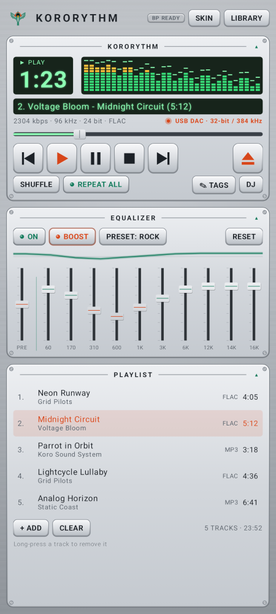
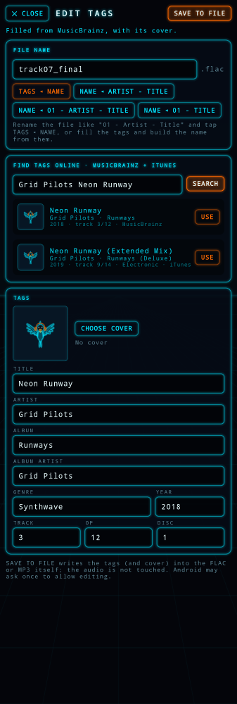

# Kororythm

An Android music player for FLAC and MP3 with a classic Winamp layout, two skins (a neon-grid look from 2000s sci-fi and a skeuomorphic hi-fi deck), DJ transitions, a tag editor that writes into your files, and bit-perfect output to USB DACs.

<p>
  
  
  
  
</p>

Built with Kotlin, Jetpack Compose and AndroidX Media3. Design: [docs/ARCHITECTURE.md](docs/ARCHITECTURE.md).

## Features (v1.0)

**Player**
- FLAC and MP3, gapless, in the background (lock screen, notification, Bluetooth and headset buttons)
- Winamp-style main, EQ and playlist panels; each rolls up into one line ("shade"); side by side in landscape
- 10-band EQ with preamp, presets and the Boost profile; spectrum and oscilloscope visualizer
- Plug animations: **Power Surge** for USB DACs, **Wings Up** for wired/Bluetooth headphones; music pauses on unplug
- **Skins:** tap SKIN to switch between Neon Grid and Hi-Fi (brushed aluminium, green LCD windows, chrome keys); remembered
- Home-screen widget: now playing with ⏮ ⏯ ⏭

**Library**
- Room database with search; tracks, albums, artists and your own albums, with cover art
- **Upload to the Grid** import wizard (phone library and/or folders), background scan, duplicate detection, rescans every 12 h
- **Compile Program** album wizard

**Tag editor** (✎ on any track, or ✎ TAGS on the player)
- Edit title, artist, album, album artist, genre, year, track/total, disc and cover, **saved into the file itself**
- Search two public databases at once, **MusicBrainz** (covers from the Cover Art Archive) and **Apple iTunes Search**, and fill everything in one tap
- Rename the file from the tags ("01 - Artist - Title"…) or fill the tags from the file name
- FLAC (Vorbis comments + picture) and MP3 (ID3v2.4) writers: the audio bytes are copied untouched, and tags it doesn't manage (ReplayGain, comments, lyrics) are kept

**DJ** (DJ button on the player)
- Transitions on Next and at the end of songs (auto-mix): cut, crossfade, echo out, filter sweep, vinyl brake, rewind, scratch, with adjustable length
- Tempo ±8 % with key lock; hot cues A–D per track
- FX pads: echo, flanger, gate, bitcrush, beat repeat ½ / ¼, low/high-pass filter knob (beat-synced to the song's BPM)
- Background analysis of every track's **BPM** and **loudness** (EBU R128); optional volume levelling

**Bit-perfect** (DJ ▸ Sound, Android 14+ with a USB DAC that supports it)
- Asks Android for a BIT_PERFECT mixer at each song's own sample rate, turns all effects off, and plays 24-bit files as 32-bit float (exact) instead of cutting them to 16 bits. The header lamp reads BIT-PERFECT only while it's really on.

## How it was checked

- 34 unit tests: EQ and Boost gains, FFT, tag rules, MusicBrainz parsing, DJ effects (fade curves, brake, rewind, effect pads), loudness against the EBU reference, BPM on synthetic drum tracks (95, 128, 174 BPM), and tag writing on real FLAC/MP3 files made with ffmpeg
- `scripts/verify_tags.py` re-reads the written files with **mutagen** and decodes them with **ffmpeg**: all tags correct, audio bit-identical to the original
- 24 Paparazzi screenshots of every screen in both skins (`app/src/test/snapshots/images/`)
- The database upgrade from v0.2 (library) to v1.0 was run against SQLite and matches Room's schema

Not yet tested on a real phone. Timing of DJ transitions, bit-perfect output and tag saving on specific phones and storage providers need a device.

## Build

Requires JDK 17+ and the Android SDK (platform 35).

```
./gradlew :app:assembleDebug          # app/build/outputs/apk/debug/app-debug.apk
./gradlew :app:testDebugUnitTest      # unit + screenshot tests
python3 scripts/verify_tags.py        # independent check of the tag writer (needs mutagen + ffmpeg)
./gradlew :app:recordPaparazziDebug   # re-render the screenshots
```

GitHub Actions runs all of this on every push to `main` and uploads both APKs. The release APK is signed with the debug key until a release keystore is added.
