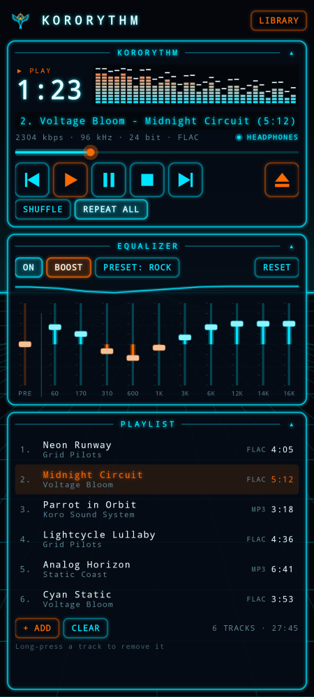
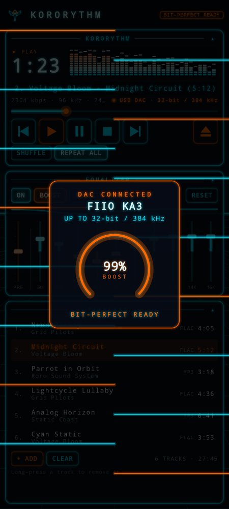
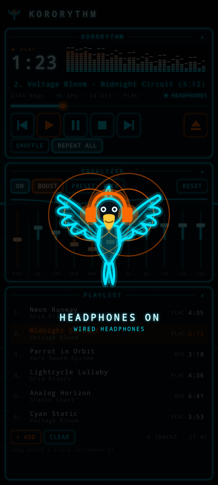
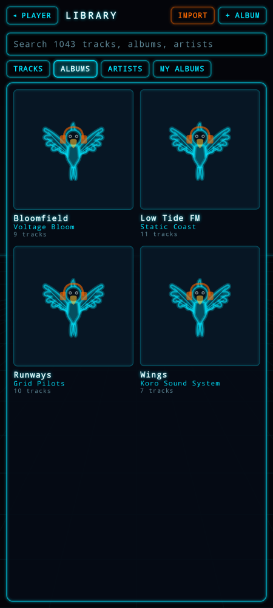
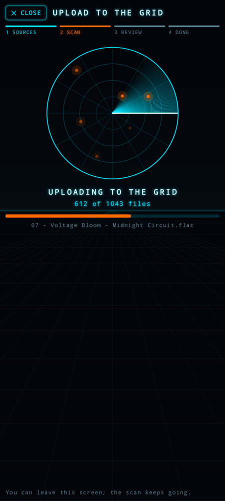
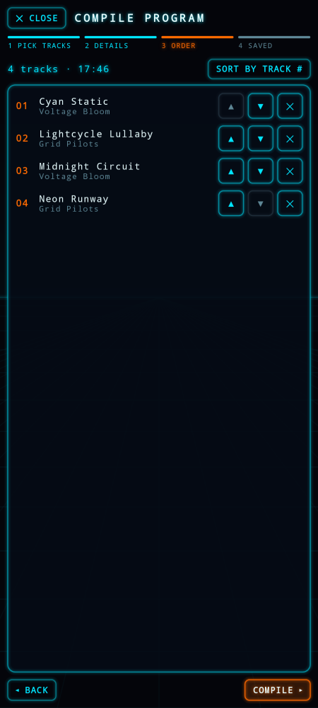

# Kororythm

An Android music player for FLAC and MP3 with a classic Winamp layout and a neon-grid look from 2000s sci-fi.

<p>
  
  
  
</p>

Built with Kotlin, Jetpack Compose and AndroidX Media3. Full design: [docs/ARCHITECTURE.md](docs/ARCHITECTURE.md).

<p>
  
  
  
</p>

## Status: phase 2 (library + wizards)

**New in phase 2**

- Music library (Room database with full-text search): tracks, albums, artists and your own albums, with cover art
- **Upload to the Grid** import wizard: pick the phone's music library and/or folders (phone or SD card), scan in the background with a radar animation, then review tracks with missing tags and fill them from MusicBrainz in one tap
- Smart sync: unchanged files are skipped, changed files updated, deleted files removed, and the same song found twice is counted as a duplicate and skipped
- Folders are rescanned on their own every 12 hours (when the battery isn't low)
- **Compile Program** album wizard: pick tracks, set title, artist, year, genre and a cover, order them, save; auto-fills details from the picked tracks
- Library > Play all / Add, tap a track to play from there, long-press to add it to the queue

**From phase 1**

- FLAC and MP3 playback, gapless, in the background (lock screen, notification, Bluetooth and headset buttons)
- Winamp-style main, EQ and playlist panels, each with a "shade" button that rolls it into one line; side by side in landscape
- 10-band EQ (60 Hz – 16 kHz) with preamp, presets and the Boost profile, saved between launches
- Spectrum bars and oscilloscope (tap the visualizer to switch), fed from the audio itself, so no microphone permission
- Readout of kbps, kHz, bit depth and codec, plus an output lamp (speaker, headphones, Bluetooth, USB DAC)
- Plug animations: **Power Surge** for USB DACs (with a haptic pulse), **Wings Up** for wired and Bluetooth headphones, a scan line for other outputs, and the reverse animation on unplug (music pauses)
- Detects whether a DAC supports bit-perfect output (Android 14+) and shows "BIT-PERFECT READY"
- Parrot icon: adaptive, with an Android 13 themed-icon layer, and a splash screen where the parrot flaps its wings
- Playlist kept between launches; "Open with Kororythm" from file managers

**Not yet (later phases)**

- Writing edited tags back into the music files (tag fixes and your albums live in the Kororythm library for now), drag-and-drop reordering, ReplayGain and BPM analysis
- DJ transitions on Next, decks and FX (phase 3)
- Actually switching the DAC into bit-perfect mode, and full 24-bit processing (phase 4). Right now the EQ path runs at 16-bit, so 24-bit FLAC plays, but it may be reduced to 16-bit
- Bundled display font: readouts use the system monospace font for now

## Build

Requires JDK 17+ and the Android SDK (platform 35).

```
./gradlew :app:assembleDebug          # app/build/outputs/apk/debug/app-debug.apk
./gradlew :app:testDebugUnitTest      # DSP + library logic tests (EQ, FFT, tag rules, MusicBrainz parsing)
./gradlew :app:recordPaparazziDebug   # re-render the screenshots without a phone
```

GitHub Actions builds both APKs on every push to `main` and uploads them as an artifact.
