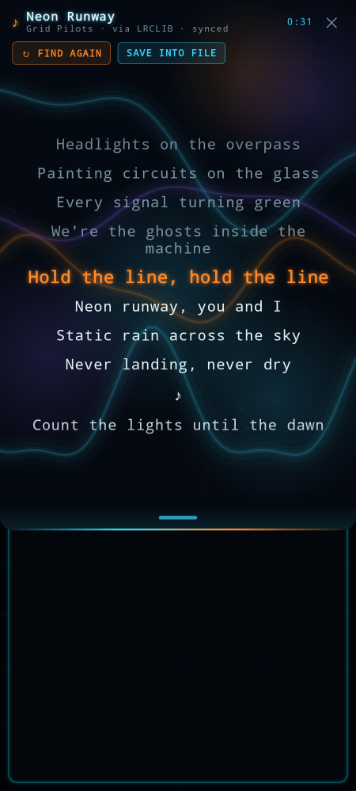

# Kororythm

An Android music player for FLAC and MP3 with a classic Winamp layout, two skins (a neon-grid look from 2000s sci-fi and a skeuomorphic hi-fi deck), DJ transitions, a tag editor that writes into your files, bit-perfect output to USB DACs, and (since v1.1) a yt-dlp download screen, playlists, cover flow, synced lyrics and one-tap quality upgrades.

<p>
  
  
  
  
</p>
<p>
  
  
  
  
</p>

Built with Kotlin, Jetpack Compose and AndroidX Media3. Design: [docs/ARCHITECTURE.md](docs/ARCHITECTURE.md).

## Kororythm for Windows (2.2) — `desktop/`

A Windows version written in Go, with the same skins, equalizer and play queue as the phone app.

- **Classic layout as real floating windows**: player, equalizer, playlist and library are separate windows. Drag one by its title strip and it snaps to the others and to the screen edges; windows docked to the player move with it; double-click a title strip to shade a window down to one line. Each window remembers its place.
- **Go audio engine**: FLAC (16/24-bit, any sample rate) and MP3, gapless hand-over between songs, optional crossfade, the same 10-band EQ, presets and Boost as Android, and a live spectrum.
- **Library**: watches your music folders (Music by default), reads tags and cover art, and browses by artist, album, song, genre and decade, with search.
- **Play next / Add to end**, shuffle and repeat, with the playlist split into *From <list>* and *Queued by you* sections.
- **Skins**: Neon, HiFi, Pod and Chrome Deck. **Tray icon** keeps music playing with every window hidden.

Install: download `Kororythm-<version>-Windows.zip` from the *Windows build* workflow, unzip, run the setup. It installs for your user only (no admin rights) and needs the Microsoft Edge WebView2 Runtime, which Windows 11 and most Windows 10 PCs already have.

Develop: `cd desktop && go test ./...`; `go run ./cmd/kororythm-dev -music <folder>` serves every window to a browser at `/dev.html` on any OS (no sound) for quick work on the interface.

**New in 2.0 beta — four layouts.** Switch with the parrot menu on any title bar, the tray icon, *Settings → Layout*, or Ctrl+1–4:

- **Classic** — the floating Winamp-style windows above.
- **Pod** — a window shaped like an iPod: screen and click wheel only. Drag round the wheel (or use the mouse wheel / arrow keys) to scroll menus, Enter is the centre button, Esc is MENU. Music → Playlists, Artists, Albums, Songs, Genres, Decades; Shuffle Songs; Now Playing (the wheel is volume, centre press scrubs).
- **Prism** — a Windows 7-style media player window: glass frame, File / View / Play / Tools / Help menus, library tree, the PRISM light show from Android, and a glossy control bar with a round play button. Tools → Equalizer opens an EQ drawer.
- **Cover Stage** — a phone-shaped window with the spring-driven cover flow, title, seek, transport and *Up next*.
- **iPod browser everywhere** — Ctrl+B opens the iPod over any layout to walk the library with the wheel.
- **Playlists on the PC** (no duplicates), saved from the queue or with *Add to playlist…*; play counts are kept for sync.
- **Downloads** (Ctrl+D) — paste a link, fetch (stoppable), pick playlist songs, save as tagged MP3 (V0 or 320) into *Music\Kororythm Downloads*, with a live LOG. yt-dlp and ffmpeg are fetched from their GitHub releases the first time.

**New in 2.1 / 2.2 — phone ⇄ PC sync, like iTunes** (protocol: [`protocol/SYNC.md`](protocol/SYNC.md)):

- **Pair once:** on the PC, Ctrl+Y (or the parrot or tray menu) opens *Sync with phone*. Press *PAIR A PHONE* and type the 6-digit code on the phone under *LIBRARY ▸ SYNC*. The code is never sent over the network: each side proves it knows the code, and the phone then pins the PC's certificate.
- **Two-way:** songs the PC has go to the phone, and the phone's songs go to the PC (into *Music\Kororythm Sync*). Songs are matched by their audio, so retagging a song doesn't create a duplicate. Playlists sync by name, and the newer edit wins. Play counts from both sides are added up. Transfers that get cut off resume where they stopped.
- **Animated on both sides:** a radar while searching, then a glowing arc between the PC and the phone with album covers flying along it in the direction they travel, a progress ring, and the parrot landing on the phone when it's done.
- **Wi-Fi, USB tethering or a cable:** the phone finds the PC by broadcast on any network it is on, including USB tethering. With *USE USB CABLE* on the PC (it fetches adb once and needs USB debugging on the phone), the phone connects through the cable even with no network at all. You can also type the PC's address.
- **Selective sync (2.2):** everything, or only chosen PC playlists. A storage bar sets how much space to keep free on the phone, and songs that don't fit wait for the next sync. Hi-res FLAC can arrive as 16-bit FLAC (converted on the PC with ffmpeg). The phone can also sync by itself on Wi-Fi while charging.

## New in v2.2 (Android) — sync with your PC

*LIBRARY ▸ SYNC* finds Kororythm on your PC (over Wi-Fi, USB tethering or a USB cable), pairs with the code the PC shows, and then syncs both ways: songs, playlists and play counts. While it works, it shows the radar, the covers flying along the arc and the parrot landing on the phone. Options: sync only some playlists, how much space to keep free, hi-res as 16-bit FLAC, and auto-sync on Wi-Fi while charging. The phone now counts plays (after 15 s of listening). See the Windows section and `protocol/SYNC.md`.

## New in v2.0 (Android) — iPod menus and the Windows 7 bar

- **Pod layout:** MENU now opens real iPod menus: Music → Playlists, Artists, Albums, Songs,
  Genres, Decades; Up Next; Now Playing; Shuffle Songs; Settings (shuffle, repeat, layout, skin).
  Turn the wheel to move, press the centre to open or play, MENU to go back a level. Levels slide
  in and out like the real thing, and rows can be tapped too.
- **Browse with the wheel anywhere:** the small click-wheel button next to STYLE (Classic,
  Cover Stage, Prism) opens the same menus in a sheet with its own click wheel.
- **Prism:** the controls are now a Windows 7 media-player bar: smoked glass, a glowing seek
  line, the round play orb joined to ⏮ / ⏭, stop, shuffle, repeat and lyrics, tinted per skin.

## New in v1.6 — Play next / Add to end

- Tap **+** on a song (or **+ QUEUE** on an album or playlist) and choose **Play next** (right after the current song) or **Add to end** (after everything already lined up). The song's ⋮ menu has both too.
- Several *Play next* songs keep the order you picked them.
- The **Playlist** window now shows where each song came from: **FROM <list>** for the album or playlist you started, and **QUEUED BY YOU · PLAYS NEXT / AT THE END** for songs added on the fly. The marks survive a restart.

## New in v1.5.2 — Cover Flow

- **Cover Stage is now a real cover flow**: the whole queue sits on one strip, the song in the middle faces you and its neighbours turn towards it.
- Every song change glides: swipe and fling through covers (with a soft tick per cover), or let next / previous, the library or the end of a track slide the strip with a spring. Long jumps skip ahead and only glide the last few covers.
- Tap the middle cover to play / pause, tap a side cover to play it. The backdrop cross-fades and the title slides in from the side the new cover came from.

## New in v1.5.1 — layout polish

- **Cover**: the art, its reflection and the song name now sit together as one block; the deck is symmetric (shuffle · prev · play · next · lyrics) with 48 dp+ keys; bigger, readable *Up next* covers.
- **Pod**: the wheel's ⏮ ⏭ ⏯ and MENU sit on one ring and no longer touch the rim; darker labels for contrast on light skins.
- **Prism**: soft scrims keep the title and the top buttons readable over the brightest colours; the gesture hint shows once and fades.
- **Style sheet**: descriptions wrap instead of being cut off, white swatches get an outline, the choice is announced as a radio option.
- Hand-drawn shuffle and lyrics icons replace text glyphs; every transport key now has a TalkBack label.

## New in v1.5

- **Layouts** — tap **◐ STYLE** on the player to switch between four main-screen layouts:
  - **Classic** — the original Winamp deck.
  - **Cover** — big album art with reflection over a blurred backdrop, swipe for next/previous, an *Up next* strip.
  - **Pod** — classic iPod: screen plus click wheel. Spin the wheel for volume, tap the centre to scrub (spin to seek), MENU for the queue.
  - **Prism** — a full-screen visualizer inspired by the Xbox 360 music visualizer: radial rainbow streaks and chrome droplets driven by the music (video-feedback engine, no external assets). Tap to show controls, double-tap to play/pause.
- **Two new skins** — **Pod** (white and silver) and **Chrome Deck** (skeuomorphic brushed chrome with screws and sheen).
- **Share** — long-press a song in the Library → *Share…* to send the audio file to any app.
- **No duplicates in playlists** — adding a song that is already in a playlist is skipped and reported.

## New in v1.4

**Bulk edit** (hidden panel: press **Volume Up, Volume Down, Volume Up** within 2 seconds anywhere in the app; the volume still changes as usual)
- Filter the library, tick songs one by one or **ALL SHOWN**, **ONLY SEL.** to review the selection
- Tick ARTIST, ALBUM, ALBUM ARTIST, GENRE or YEAR and type the value: **APPLY TO N SONGS** writes it into every selected FLAC/MP3 (one Android permission dialog for all of them) and updates the library; everything else in each file (title, track numbers, cover, lyrics) is kept, and ID3v2.3 files come out as v2.4. Empty value = remove that field
- **☰ ADD N TO PLAYLIST** puts the selection into an existing playlist or a new one
- Verified: unit tests plus mutagen/ffmpeg checks that only the chosen fields change and the audio stays bit-identical

## New in v1.3

- **Delete file** (⋮ ▸ Delete file…): asks first, removes the file from the phone (Android may ask once) and the song from the library, its playlists, hot cues and the queue
- **Replace with a download:** when a finished download looks like a song you already have (title and artist compared without "(Official Video)", "feat." credits, accents or punctuation), the queue offers **⇄ REPLACE IT** or **KEEP BOTH**. Replacing runs Upgrade quality: an honest before/after comparison, the file swapped into the old song's folder under its name and tags, playlists and hot cues kept, and the separate downloaded copy removed. The Downloads screen also warns before you download a song you already have
- **↻ Refresh** in the library header checks that every song's file still exists (and still has permission), then shows a pop-up listing the missing ones with **REMOVE FROM LIBRARY** / **KEEP**, or "All files present ✓"; it also rescans your folders for new files
- **Decade filter:** chips under the tabs (ALL YEARS, 1970s, 1980s, … , No year) with counts; pick several (e.g. 1990s + 2000s) and Tracks, Albums, Artists, Genres and any open album, genre or playlist show only those years; track rows now show the year

## New in v1.2

**⚑ Needs tags** (Library tab, plus an orange banner when there are any)
- Lists songs with thin metadata (title from the file name, no artist or album, or two of year / genre / cover missing), worst first, each with "no artist", "no year"… chips
- **FIX ONE BY ONE** walks the tag editor through them: SAVE, then NEXT ▸ (or SKIP ▸), with "FIX 3/17" in the title

**Genres and sub-genres**
- A background lookup fills in a broad genre and a finer sub-genre for every song: the file's own genre, MusicBrainz tags of the recording, genres of its album and artist (each asked once), and iTunes' genre as a fallback; one request per second, as MusicBrainz asks
- It runs after imports, downloads and tag edits, and from **FIND GENRES**; offline it waits and tries again instead of giving up
- Sub-genres are sorted into 16 families (Electronic ▸ Synthwave, Latin ▸ Vallenato / Champeta / Reggaeton, Rock ▸ Post-Punk…)
- **GENRES** tab: each family with its count and sub-genre chips; tap either to list (and play / cover-flow) those songs
- The tag editor offers the found genre for files that have none, so SAVE writes it into the file


**Downloads** (⇩ GET in the library, or share a link from YouTube to Kororythm)
- Embedded **yt-dlp** with Python and FFmpeg ([youtubedl-android](https://github.com/JunkFood02/youtubedl-android)); works with YouTube, YouTube Music and the other sites yt-dlp supports
- Paste or share a link, check the cleaned-up title and artist, then save as **MP3 V0** (tagged, with the thumbnail as a square cover) or the **original stream** (Opus/AAC, no re-encoding)
- Files go to **Music/Kororythm** on the phone and straight into the library; downloads keep running in the background with a notification and can be cancelled
- Honest quality label: it shows the source stream (e.g. "Opus 135 kbps") and stores it in the MP3, so Upgrade quality never treats a re-encoded download as better than its source
- **UPDATE ENGINE** pulls the newest stable yt-dlp when a site changes
- **Reading a link is live and stoppable:** yt-dlp's output scrolls under the link with the elapsed time, a warning after 20 s without output, and **■ STOP**
- **Playlists and mixes:** the link lists every item (up to 300); tick the ones you want (ALL / NONE; a "watch?v=…&list=…" link preselects that video), optionally give them one album name, and download; two downloads run at a time, **CANCEL ALL** stops the rest; each item's real source quality is measured as it downloads
- Downloads that stop printing for 30 s are flagged "may be stuck" next to CANCEL
- **LOG** on each download opens a live, verbose console: the exact yt-dlp command, its output and debug lines, warnings, and every step Kororythm takes (cover, tags, where it saved, library entry); **COPY LOG** for sharing

**Playlists**
- Create, rename, delete; add from any track's ⋮ menu; reorder (▲ ▼) and remove; **SAVE ☰** in the player saves the queue as a playlist

**Upgrade quality** (gold ✦ HQ chip on lossy tracks, or ⋮ ▸ Upgrade quality)
- Pick a FLAC or a higher-bitrate MP3; Kororythm compares them (lossless beats lossy; MP3 must be clearly higher; FLAC must be higher resolution) and explains a "not better" verdict
- Writes the new file into the **same folder** with the old name, tags, cover and lyrics, removes the old file (Android asks once), and keeps the library row, so **hot cues and playlists stay**
- **POWER UP!** pop-up with light burst, rings and the before → after figures (e.g. ×7.4 more sound data)

**Cover flow** (◫ COVER FLOW in Albums, Playlists and inside any album or playlist; ◫ in the player's playlist panel for the queue): turned covers with floor reflections; flick, snap, tap to open or play

**Lyrics console** (♪ LYRICS on the player, or ⋮ ▸ Lyrics)
- Drops down from the top over any screen like a Guake terminal; drag the grip up, tap below or press Back to put it away
- Behind the text, an Ambience-style backdrop (ribbons of light, drifting glow orbs, rising sparks) moves with the music: bass swells the ribbons, mids the orbs, highs the sparks
- Found automatically on **LRCLIB**; synced lyrics light up line by line, scroll with the song, and tap-to-seek
- **SAVE INTO FILE** writes them into the FLAC (LYRICS) or MP3 (USLT) so other players show them too

**License:** Kororythm is now **GPL-3.0** (see [LICENSE](LICENSE) and [NOTICE.md](NOTICE.md)).

## Features (v1.0)

**Player**
- FLAC and MP3, gapless, in the background (lock screen, notification, Bluetooth and headset buttons)
- Winamp-style main, EQ and playlist panels; each rolls up into one line ("shade"); side by side in landscape
- 10-band EQ with preamp, presets and the Boost profile; spectrum and oscilloscope visualizer
- Plug animations: **Power Surge** for USB DACs, **Wings Up** for wired/Bluetooth headphones; music pauses on unplug
- **Skins:** tap SKIN to switch between Neon Grid and Hi-Fi (brushed aluminium, green LCD windows, chrome keys); remembered
- Home-screen widget: now playing with ⏮ ⏯ ⏭

**Library**
- Room database with search; tracks, albums, artists and your own albums, with cover art
- **Upload to the Grid** import wizard (phone library and/or folders), background scan, duplicate detection, rescans every 12 h
- **Compile Program** album wizard

**Tag editor** (✎ on any track, or ✎ TAGS on the player)
- Edit title, artist, album, album artist, genre, year, track/total, disc and cover, **saved into the file itself**
- Search two public databases at once, **MusicBrainz** (covers from the Cover Art Archive) and **Apple iTunes Search**, and fill everything in one tap
- Rename the file from the tags ("01 - Artist - Title"…) or fill the tags from the file name
- FLAC (Vorbis comments + picture) and MP3 (ID3v2.4) writers: the audio bytes are copied untouched, and tags it doesn't manage (ReplayGain, comments, lyrics) are kept

**DJ** (DJ button on the player)
- Transitions on Next and at the end of songs (auto-mix): cut, crossfade, echo out, filter sweep, vinyl brake, rewind, scratch, with adjustable length
- Tempo ±8 % with key lock; hot cues A–D per track
- FX pads: echo, flanger, gate, bitcrush, beat repeat ½ / ¼, low/high-pass filter knob (beat-synced to the song's BPM)
- Background analysis of every track's **BPM** and **loudness** (EBU R128); optional volume levelling

**Bit-perfect** (DJ ▸ Sound, Android 14+ with a USB DAC that supports it)
- Asks Android for a BIT_PERFECT mixer at each song's own sample rate, turns all effects off, and plays 24-bit files as 32-bit float (exact) instead of cutting them to 16 bits. The header lamp reads BIT-PERFECT only while it's really on.

## How it was checked

- 45 unit tests: EQ and Boost gains, FFT, tag rules, MusicBrainz parsing, DJ effects (fade curves, brake, rewind, effect pads), loudness against the EBU reference, BPM on synthetic drum tracks (95, 128, 174 BPM), tag and lyrics writing on real FLAC/MP3 files made with ffmpeg; v1.1 adds LRC parsing, LRCLIB response handling, the upgrade rules, the YouTube source note, link and title cleanup
- `scripts/verify_tags.py` re-reads the written files with **mutagen** and decodes them with **ffmpeg**: all tags and lyrics correct, audio bit-identical to the original
- 48 Paparazzi screenshots of every screen in both skins (`app/src/test/snapshots/images/`)
- Both database upgrades (v1 → v2 → v3) were run against SQLite and match Room's schema
- The release build was checked to keep the yt-dlp, Python and FFmpeg libraries and the classes they load by reflection

Not yet tested on a real phone. Timing of DJ transitions, bit-perfect output, tag saving on specific storage providers, and real downloads (the build machine can't reach YouTube) need a device.

## Build

Requires JDK 17+ and the Android SDK (platform 35).

```
./gradlew :app:assembleDebug          # app/build/outputs/apk/debug/app-arm64-v8a-debug.apk (+ armeabi-v7a)
./gradlew :app:testDebugUnitTest      # unit + screenshot tests
python3 scripts/verify_tags.py        # independent check of the tag writer (needs mutagen + ffmpeg)
./gradlew :app:recordPaparazziDebug   # re-render the screenshots
```

GitHub Actions runs all of this on every push to `main` and uploads the APKs. There is one APK per CPU type (yt-dlp brings Python and FFmpeg per type): **arm64-v8a** for any recent phone (~57 MB), armeabi-v7a for older 32-bit ones. The release APK is signed with the debug key until a release keystore is added.

## License

Copyright (C) 2026 Jose Acosta Hernandez. Kororythm is free software under the [GNU General Public License v3.0](LICENSE). Third-party components and services are listed in [NOTICE.md](NOTICE.md). Download only content you have the right to keep.
