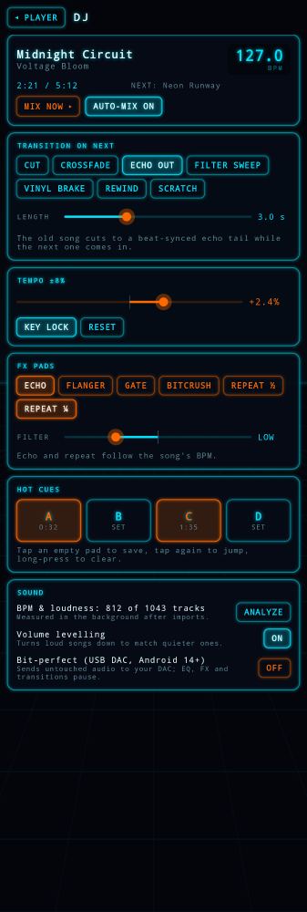
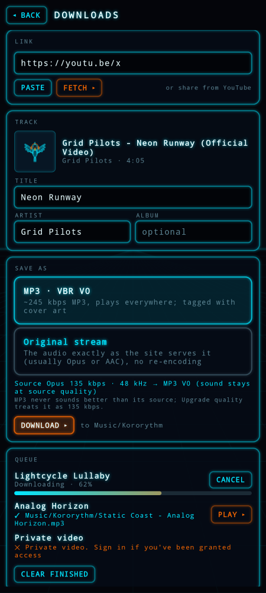
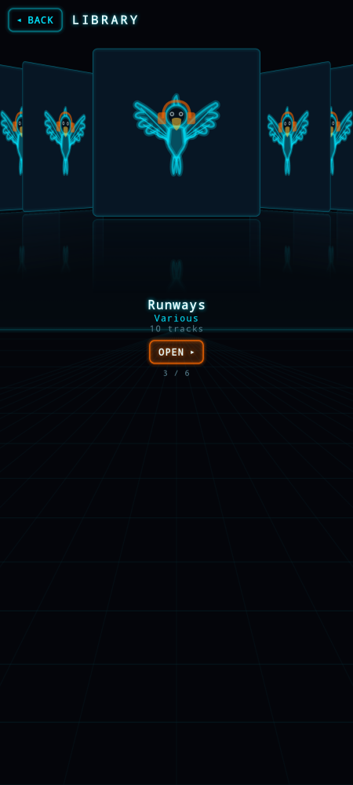
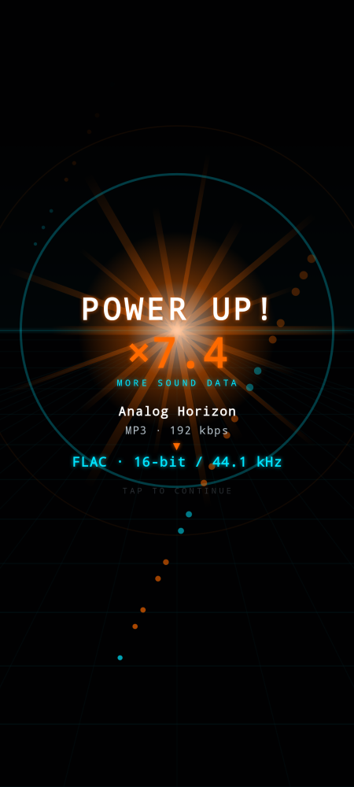

# Kororythm

An Android music player for FLAC and MP3 with a classic Winamp layout, two skins (a neon-grid look from 2000s sci-fi and a skeuomorphic hi-fi deck), DJ transitions, a tag editor that writes into your files, bit-perfect output to USB DACs, and (since v1.1) a yt-dlp download screen, playlists, cover flow, synced lyrics and one-tap quality upgrades.

<p>
  
  
  
  
</p>
<p>
  
  
  
  
</p>

Built with Kotlin, Jetpack Compose and AndroidX Media3. Design: [docs/ARCHITECTURE.md](docs/ARCHITECTURE.md).

## New in v1.2

**⚑ Needs tags** (Library tab, plus an orange banner when there are any)
- Lists songs with thin metadata (title from the file name, no artist or album, or two of year / genre / cover missing), worst first, each with "no artist", "no year"… chips
- **FIX ONE BY ONE** walks the tag editor through them: SAVE, then NEXT ▸ (or SKIP ▸), with "FIX 3/17" in the title

**Genres and sub-genres**
- A background lookup fills in a broad genre and a finer sub-genre for every song: the file's own genre, MusicBrainz tags of the recording, genres of its album and artist (each asked once), and iTunes' genre as a fallback; one request per second, as MusicBrainz asks
- It runs after imports, downloads and tag edits, and from **FIND GENRES**; offline it waits and tries again instead of giving up
- Sub-genres are sorted into 16 families (Electronic ▸ Synthwave, Latin ▸ Vallenato / Champeta / Reggaeton, Rock ▸ Post-Punk…)
- **GENRES** tab: each family with its count and sub-genre chips; tap either to list (and play / cover-flow) those songs
- The tag editor offers the found genre for files that have none, so SAVE writes it into the file


**Downloads** (⇩ GET in the library, or share a link from YouTube to Kororythm)
- Embedded **yt-dlp** with Python and FFmpeg ([youtubedl-android](https://github.com/JunkFood02/youtubedl-android)); works with YouTube, YouTube Music and the other sites yt-dlp supports
- Paste or share a link, check the cleaned-up title and artist, then save as **MP3 V0** (tagged, with the thumbnail as a square cover) or the **original stream** (Opus/AAC, no re-encoding)
- Files go to **Music/Kororythm** on the phone and straight into the library; downloads keep running in the background with a notification and can be cancelled
- Honest quality label: it shows the source stream (e.g. "Opus 135 kbps") and stores it in the MP3, so Upgrade quality never treats a re-encoded download as better than its source
- **UPDATE ENGINE** pulls the newest stable yt-dlp when a site changes
- **Reading a link is live and stoppable:** yt-dlp's output scrolls under the link with the elapsed time, a warning after 20 s without output, and **■ STOP**
- **Playlists and mixes:** the link lists every item (up to 300); tick the ones you want (ALL / NONE; a "watch?v=…&list=…" link preselects that video), optionally give them one album name, and download; two downloads run at a time, **CANCEL ALL** stops the rest; each item's real source quality is measured as it downloads
- Downloads that stop printing for 30 s are flagged "may be stuck" next to CANCEL
- **LOG** on each download opens a live, verbose console: the exact yt-dlp command, its output and debug lines, warnings, and every step Kororythm takes (cover, tags, where it saved, library entry); **COPY LOG** for sharing

**Playlists**
- Create, rename, delete; add from any track's ⋮ menu; reorder (▲ ▼) and remove; **SAVE ☰** in the player saves the queue as a playlist

**Upgrade quality** (gold ✦ HQ chip on lossy tracks, or ⋮ ▸ Upgrade quality)
- Pick a FLAC or a higher-bitrate MP3; Kororythm compares them (lossless beats lossy; MP3 must be clearly higher; FLAC must be higher resolution) and explains a "not better" verdict
- Writes the new file into the **same folder** with the old name, tags, cover and lyrics, removes the old file (Android asks once), and keeps the library row, so **hot cues and playlists stay**
- **POWER UP!** pop-up with light burst, rings and the before → after figures (e.g. ×7.4 more sound data)

**Cover flow** (◫ COVER FLOW in Albums, Playlists and inside any album or playlist; ◫ in the player's playlist panel for the queue): turned covers with floor reflections; flick, snap, tap to open or play

**Lyrics console** (♪ LYRICS on the player, or ⋮ ▸ Lyrics)
- Drops down from the top over any screen like a Guake terminal; drag the grip up, tap below or press Back to put it away
- Behind the text, an Ambience-style backdrop (ribbons of light, drifting glow orbs, rising sparks) moves with the music: bass swells the ribbons, mids the orbs, highs the sparks
- Found automatically on **LRCLIB**; synced lyrics light up line by line, scroll with the song, and tap-to-seek
- **SAVE INTO FILE** writes them into the FLAC (LYRICS) or MP3 (USLT) so other players show them too

**License:** Kororythm is now **GPL-3.0** (see [LICENSE](LICENSE) and [NOTICE.md](NOTICE.md)).

## Features (v1.0)

**Player**
- FLAC and MP3, gapless, in the background (lock screen, notification, Bluetooth and headset buttons)
- Winamp-style main, EQ and playlist panels; each rolls up into one line ("shade"); side by side in landscape
- 10-band EQ with preamp, presets and the Boost profile; spectrum and oscilloscope visualizer
- Plug animations: **Power Surge** for USB DACs, **Wings Up** for wired/Bluetooth headphones; music pauses on unplug
- **Skins:** tap SKIN to switch between Neon Grid and Hi-Fi (brushed aluminium, green LCD windows, chrome keys); remembered
- Home-screen widget: now playing with ⏮ ⏯ ⏭

**Library**
- Room database with search; tracks, albums, artists and your own albums, with cover art
- **Upload to the Grid** import wizard (phone library and/or folders), background scan, duplicate detection, rescans every 12 h
- **Compile Program** album wizard

**Tag editor** (✎ on any track, or ✎ TAGS on the player)
- Edit title, artist, album, album artist, genre, year, track/total, disc and cover, **saved into the file itself**
- Search two public databases at once, **MusicBrainz** (covers from the Cover Art Archive) and **Apple iTunes Search**, and fill everything in one tap
- Rename the file from the tags ("01 - Artist - Title"…) or fill the tags from the file name
- FLAC (Vorbis comments + picture) and MP3 (ID3v2.4) writers: the audio bytes are copied untouched, and tags it doesn't manage (ReplayGain, comments, lyrics) are kept

**DJ** (DJ button on the player)
- Transitions on Next and at the end of songs (auto-mix): cut, crossfade, echo out, filter sweep, vinyl brake, rewind, scratch, with adjustable length
- Tempo ±8 % with key lock; hot cues A–D per track
- FX pads: echo, flanger, gate, bitcrush, beat repeat ½ / ¼, low/high-pass filter knob (beat-synced to the song's BPM)
- Background analysis of every track's **BPM** and **loudness** (EBU R128); optional volume levelling

**Bit-perfect** (DJ ▸ Sound, Android 14+ with a USB DAC that supports it)
- Asks Android for a BIT_PERFECT mixer at each song's own sample rate, turns all effects off, and plays 24-bit files as 32-bit float (exact) instead of cutting them to 16 bits. The header lamp reads BIT-PERFECT only while it's really on.

## How it was checked

- 45 unit tests: EQ and Boost gains, FFT, tag rules, MusicBrainz parsing, DJ effects (fade curves, brake, rewind, effect pads), loudness against the EBU reference, BPM on synthetic drum tracks (95, 128, 174 BPM), tag and lyrics writing on real FLAC/MP3 files made with ffmpeg; v1.1 adds LRC parsing, LRCLIB response handling, the upgrade rules, the YouTube source note, link and title cleanup
- `scripts/verify_tags.py` re-reads the written files with **mutagen** and decodes them with **ffmpeg**: all tags and lyrics correct, audio bit-identical to the original
- 48 Paparazzi screenshots of every screen in both skins (`app/src/test/snapshots/images/`)
- Both database upgrades (v1 → v2 → v3) were run against SQLite and match Room's schema
- The release build was checked to keep the yt-dlp, Python and FFmpeg libraries and the classes they load by reflection

Not yet tested on a real phone. Timing of DJ transitions, bit-perfect output, tag saving on specific storage providers, and real downloads (the build machine can't reach YouTube) need a device.

## Build

Requires JDK 17+ and the Android SDK (platform 35).

```
./gradlew :app:assembleDebug          # app/build/outputs/apk/debug/app-arm64-v8a-debug.apk (+ armeabi-v7a)
./gradlew :app:testDebugUnitTest      # unit + screenshot tests
python3 scripts/verify_tags.py        # independent check of the tag writer (needs mutagen + ffmpeg)
./gradlew :app:recordPaparazziDebug   # re-render the screenshots
```

GitHub Actions runs all of this on every push to `main` and uploads the APKs. There is one APK per CPU type (yt-dlp brings Python and FFmpeg per type): **arm64-v8a** for any recent phone (~57 MB), armeabi-v7a for older 32-bit ones. The release APK is signed with the debug key until a release keystore is added.

## License

Copyright (C) 2026 Jose Acosta Hernandez. Kororythm is free software under the [GNU General Public License v3.0](LICENSE). Third-party components and services are listed in [NOTICE.md](NOTICE.md). Download only content you have the right to keep.
