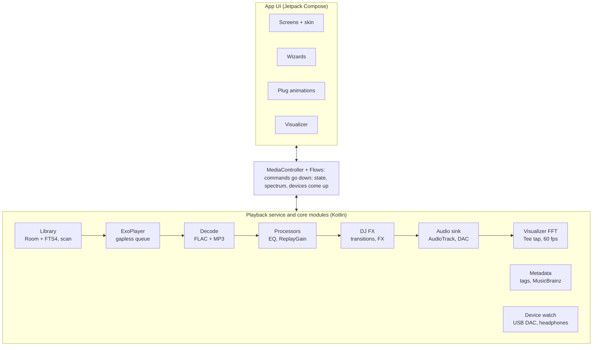
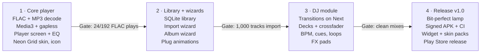

# Kororythm — Architecture Blueprint

_Nov 17, 2026 · living version: https://claude.ai/artifact/8G9purtHvHZQCbdq2Ng2Yf_

## Vision and scope

Kororythm is an Android music player for FLAC and MP3 with a classic Winamp layout and a neon-grid look from 2000s sci-fi. It plays audio bit-perfect, manages a library through wizards, and adds DJ-style transitions and plug-in animations for DACs and headphones.

**MVP (first build):**

- Play FLAC (16/24-bit, up to 192 kHz) and MP3, gapless, with a playlist
- Classic main panel, 10-band EQ, playlist editor and spectrum/oscilloscope visualizer
- Neon-grid skin and the parrot icon
- Import wizard (folders to library)
- DAC and headphone detection with their animations

**Later:** album-creation wizard, DJ decks and FX, tag editing, ReplayGain scanning, skin packs, home-screen widget, Android Auto.

**Out of scope for v1:** streaming services, video, iOS and desktop builds.

The skin is an original design in the neon-grid style. It uses no film logos, names, fonts or characters, so the project stays safe to publish open source.

## Tech stack

Native Android in Kotlin, with Jetpack Compose for the UI and AndroidX Media3 for playback. Compose's Canvas and AGSL shaders (Android 13+) handle the glow, grid and animations. Min SDK 26 (Android 8); bit-perfect DAC output turns on only on Android 14+.

| Layer | Choice | Why |
| --- | --- | --- |
| Language / UI | Kotlin + Jetpack Compose, Canvas + AGSL shaders | Custom neon drawing at 60 fps, easy animation APIs |
| Playback | Media3 ExoPlayer + MediaSessionService | Gapless, background play, lock screen, notification, Bluetooth and headset buttons |
| FLAC decode | Media3 FLAC extension (libflac) | Reliable 24-bit and high sample rates on every phone |
| MP3 decode | Media3 built-in (MediaCodec) | Standard, hardware where available |
| DSP | Custom Media3 `AudioProcessor` chain, float output on | Same EQ sound on every phone (no vendor `audiofx` quirks) |
| Spectrum tap | Media3 `TeeAudioProcessor` + FFT | No microphone permission (the system Visualizer needs one) |
| DAC output | `AudioMixerAttributes` with `BIT_PERFECT` (API 34+) | Sends audio untouched to USB DACs |
| Device events | `AudioManager.registerAudioDeviceCallback` | Plug/unplug of USB DACs, wired and Bluetooth headphones |
| Library DB | Room (SQLite) with an FTS4 table | Fast search, Kotlin Flow updates |
| Scanning | MediaStore + Storage Access Framework folders, WorkManager jobs | Finds music, survives the app closing |
| Tags | JAudioTagger (Android fork) | Read and write ID3 and FLAC Vorbis comments |
| Metadata lookup | MusicBrainz + Cover Art Archive over OkHttp/Retrofit, Coil for images | Free, open data for the wizards |
| DJ native (phase 3) | Oboe (C++) + SoundTouch for time-stretch | Low latency for scratch, key lock and decks |
| DI / build | Hilt, Gradle, GitHub Actions | Signed APK and Play Store bundle (AAB) |

Sources: [Android: improve audio playback](https://developer.android.com/media/platform/improve-audio-playback), [AOSP: preferred mixer attributes on USB](https://source.android.com/docs/core/audio/preferred-mixer-attr)

## System architecture

Commands go down to the playback service; state and sound data come back up.



Audio runs left to right inside the playback service. The library feeds content URIs into ExoPlayer's queue, the tee tap copies samples to the FFT for the visualizer, and device events go up to the UI to trigger the animations.

## Audio engine

The engine is Media3 ExoPlayer running inside a `MediaSessionService`, so music keeps playing with the screen off and shows on the lock screen. Audio is decoded to float and passes through Kororythm's own processor chain before the system audio sink. In bit-perfect mode the chain is bypassed.

1. **Source:** ExoPlayer playlist built from library tracks (content URIs). Gapless is native in Media3; it reads LAME/iTunes gap info for MP3 and is sample-exact for FLAC.
2. **Decode:** FLAC through the Media3 FLAC extension (libflac); MP3 through MediaCodec. Float output is on, so 24-bit sources keep full resolution.
3. **Processor chain** (custom `AudioProcessor`s; each stage can be toggled):
   - ReplayGain (track or album) with a peak limiter
   - Preamp + 10-band graphic EQ (Winamp bands 60 Hz to 16 kHz), as biquad peaking filters
   - DJ transition FX (see DJ module)
   - Optional "Boost" profile: loudness curve + soft clipper, with 3 dB headroom
   - `TeeAudioProcessor` tap: copies samples to the FFT
4. **Output:** Media3's audio sink to `AudioTrack`. With a USB DAC on Android 14+, Kororythm sets preferred mixer attributes to the file's native rate and bit depth, and to `BIT_PERFECT` when the phone supports it.
5. **Visualizer:** FFT (2048 points, Hann window) on a background thread; 64 bars + oscilloscope samples go to Compose through a `StateFlow` at 60 fps.
6. **UI link:** the Compose screens talk to the service through a Media3 `MediaController`, so the widget, notification, Bluetooth buttons and the app all control the same player.

**Player state machine:** Stopped → Loading → Playing ⇄ Paused → Stopped, plus Transitioning (when DJ FX runs between tracks). Every command (play, seek, next) is a message on one channel, so state changes stay ordered.

**Bit-perfect rule:** USB DAC on Android 14+ that offers BIT_PERFECT + EQ, ReplayGain, Boost and DJ FX all off + file format the DAC supports. The UI shows a "BIT-PERFECT" lamp only when all of these hold.

## Device detection and plug animations

A `DeviceWatcher` registers `AudioManager.registerAudioDeviceCallback`. Each added or removed `AudioDeviceInfo` is sorted by its type, and the app reads its name and supported sample rates and encodings to show what it can do.

| Kind | How it's detected | Animation | Engine action |
| --- | --- | --- | --- |
| USB DAC | `TYPE_USB_DEVICE` or `TYPE_USB_HEADSET` | **"Power Surge":** neon lines race in from the screen edges, a panel shows the DAC name and its max format (e.g. 32-bit / 384 kHz), a BOOST gauge sweeps to full, plus a short haptic pulse | Offers bit-perfect mode (Android 14+), loads that DAC's saved EQ profile |
| Wired headphones | `TYPE_WIRED_HEADPHONES` or `TYPE_WIRED_HEADSET` | **"Wings Up":** the parrot spreads its wings, its headphones glow, a ring pulses out from the cups | Loads the headphone EQ profile |
| Bluetooth headphones | `TYPE_BLUETOOTH_A2DP` or `TYPE_BLE_HEADSET` | "Wings Up" in blue, with the codec shown when the phone reports it | Loads that headset's profile |
| Phone speaker / other | Anything else | Short cyan scan line | Loads the default profile |

- **Unplug:** the reverse animation (lines retract, wings fold). Media3 pauses on `ACTION_AUDIO_BECOMING_NOISY`, so music never blasts from the speaker.
- **Debounce:** events within 500 ms are merged, because USB DACs often show up as several devices.
- **Profiles:** stored per device (type + name) in Room: EQ, preamp, output mode, volume.
- **USB permission:** using a DAC through the normal Android audio path needs no USB permission prompt; Kororythm never talks to the USB device directly.
- **Honesty note:** "Boost" is a loudness and EQ profile plus headroom management. The real quality gain from a DAC comes from bit-perfect output, which is what the BIT-PERFECT lamp shows.

## DJ module

Pressing Next (or a track ending) runs the chosen **transition**, so skipping a track sounds like a DJ mix instead of a hard cut. A DJ panel slides up from the player screen to show the controls. Phase 1-2 transitions run in Kotlin with two ExoPlayer instances and volume ramps; the full DJ deck in phase 3 moves to a native Oboe engine.

| Transition | What you hear | Default length |
| --- | --- | --- |
| Cut | Instant switch (classic Winamp) | 0 s |
| Crossfade | Equal-power fade between both tracks | 4 s |
| Scratch | Short vinyl-scratch sample, then the next track drops | 0.8 s |
| Rewind | Current track spins backward fast, then the next track drops | 1.2 s |
| Echo out | Delay tail on the outgoing track, next one fades in | 3 s |
| Filter sweep | Low-pass sweep closes the old track, high-pass opens the new one | 4 s |
| Vinyl brake | Pitch and speed fall to zero like a turntable stopping | 1 s |
| Beat-match (later) | Matches BPM and lines up beats before crossfading | 8 bars |

**DJ panel (phase 3):**

- Two decks (A/B) with a crossfader, waveform and BPM readout
- Pitch/tempo ±8% with key lock (time-stretch through a WSOLA/phase-vocoder stage)
- Hot cues (4 per track) and loops (1, 2, 4, 8 beats)
- FX pads: echo, flanger, filter, bitcrush, gate
- BPM and beat grid worked out at import time and stored in the library
- Button sounds: short UI clicks and "whoosh" sounds for skin buttons, which you can turn off. They play through SoundPool, separate from the music stream, so they never end up in the mix.

All transition sounds are original or CC0 samples, kept in `app/src/main/assets/sfx/`.

## Library and wizards

The library is a Room database inside the app's private storage, with tables for tracks, albums, artists, playlists, device profiles and DJ data (BPM, cues). Music files stay where they are; the database stores their content URIs and tags. Scans and analysis run as WorkManager jobs, so they finish even if you leave the app.

**Import wizard ("Upload to the Grid"):**

1. Grant the music permission (READ_MEDIA_AUDIO) and pick folders through the system folder picker; new files are picked up automatically
2. Scan: walk the folders in parallel, read tags and cover art, hash audio for duplicates
3. Review: tracks with missing tags are flagged, with one-click MusicBrainz suggestions
4. Analyze (in the background): duration, ReplayGain, BPM, waveform preview
5. Done: summary screen with counts, plus the "Upload complete" animation

**Album-creation wizard ("Compile Program"):**

1. Pick tracks from the library or a folder
2. Set album title, artist, year, genre and cover (file, or Cover Art Archive search)
3. Order tracks by drag and drop, with auto-numbering and disc numbers
4. Choose to write tags into the files (Android asks you once for write access to that folder) or keep the album as library-only
5. Optional: export as a folder copy with a clean naming scheme (`Artist/Year - Album/NN - Title.flac`)

**Other wizards:** first-run setup (permissions, music folders, test tone, notification style), smart-playlist builder (rules like genre = X and BPM > 120), and a DAC setup wizard that runs on first plug-in.

Search uses FTS across title, artist, album and genre, and returns results as you type.

## UI, skin engine and icon

**Screens (Winamp layout on a phone):** the player screen stacks the three classic Winamp panels vertically: main panel (transport, seek bar, time display, kbps/kHz readout, mini visualizer), EQ panel and playlist panel. Each panel can roll up to a thin "shade" bar, like Winamp's windowshade mode. In landscape and on tablets they sit side by side. Library, wizards and the DJ deck are full screens. A mini-player bar follows you through the app.

**Neon Grid skin (default):**

- Black background with a dark-blue perspective grid floor, cyan (#00E5FF) and orange (#FF6A00) light lines
- Thin rounded chrome with a soft outer glow; buttons light up on press with a short scan line
- Readouts in a geometric display font (an open-licence font such as Orbitron, bundled)
- Visualizer modes: light-cycle bars, oscilloscope trail, and a tunnel grid that pulses on the beat
- Startup: the grid draws itself from a horizon line, then the panels fade in

**Skin engine:** a skin is a folder with `skin.json` (colours, fonts, layout positions) and vector sprites, mapped onto a Compose theme. Skins can be swapped live without restarting. Later, a classic .wsz importer can map old Winamp bitmaps onto the layout.

**Icon:** an original parrot with its wings spread, wearing over-ear headphones, drawn in neon line-art (cyan body, orange headphones). It's built as an adaptive icon: the parrot is the vector foreground layer, the background is a dark grid, and a one-colour layer supports Android 13 themed icons. The splash screen uses an animated vector of the parrot flapping its wings once. The same parrot is the mascot in the "Wings Up" headphone animation.

**Outside the app:** media notification and lock-screen controls through the MediaSession, a home-screen widget (Jetpack Glance) styled as a mini Winamp bar, Bluetooth and headset buttons, and Android Auto later.

## Repo layout

```
kororythm/
  app/                          # Android app module (Compose UI, Hilt setup)
    src/main/java/.../ui/
      player/                   # main, EQ and playlist panels, shade mode
      library/                  # library screens, search
      wizards/                  # import, album, first-run, dac
      dj/                       # DJ panel and decks
      anim/                     # power-surge, wings-up, boot-grid
      viz/                      # Canvas/AGSL visualizers
      skin/                     # skin engine, neon-grid skin
    src/main/res/               # adaptive icon, animated splash, fonts
    src/main/assets/sfx/        # transition and UI sounds (CC0/original)
  core/playback/                # MediaSessionService, ExoPlayer setup, queue
  core/dsp/                     # AudioProcessors: eq, replaygain, boost, tee+FFT
  core/devices/                 # DeviceWatcher, mixer attributes, profiles
  core/library/                 # Room DB, MediaStore/SAF scanner, WorkManager jobs
  core/meta/                    # JAudioTagger, MusicBrainz, cover art
  core/dj/                      # transitions (Kotlin), later Oboe JNI bridge
  native/dj-engine/             # C++ Oboe + SoundTouch (phase 3)
  widget/                       # Glance home-screen widget
  docs/ARCHITECTURE.md          # this blueprint
  .github/workflows/            # build, test, signed APK/AAB
```

## Roadmap

Phase 1 starts today; each phase opens only when its gate passes.



Today's build target is phase 1: an APK that opens a FLAC file, plays it in the background through Media3 with a working seek bar and EQ, and wears the Neon Grid skin. Phase 2 starts once 24-bit/192 kHz FLAC plays with no dropouts.

## Risks and open decisions

- **Bit-perfect depends on the phone.** The `BIT_PERFECT` mode is optional for phone makers and only exists on Android 14+. Fix: check `getSupportedMixerAttributes` per DAC and show the lamp only when it's really on; otherwise fall back to the DAC's native rate.
- **Vendor audio quirks** (Samsung, Xiaomi and others resample or add effects). Using our own `AudioProcessor` EQ instead of the system `audiofx` keeps the sound the same on every phone.
- **Battery:** a 60 fps visualizer and shader glow drain power. Fix: drop to 30 fps on battery saver and stop drawing when the screen is off.
- **Background limits:** Android can kill apps in the background. The `MediaSessionService` runs as a foreground service with the media notification, which Android allows for playback.
- **Time-stretch and scratch** need native code (Oboe + SoundTouch through JNI), which is why the full DJ deck waits for phase 3. SoundTouch is LGPL, so it ships as a separate shared library.
- **Storage access:** writing tags needs folder permission through the system picker; the album wizard asks once per folder.
