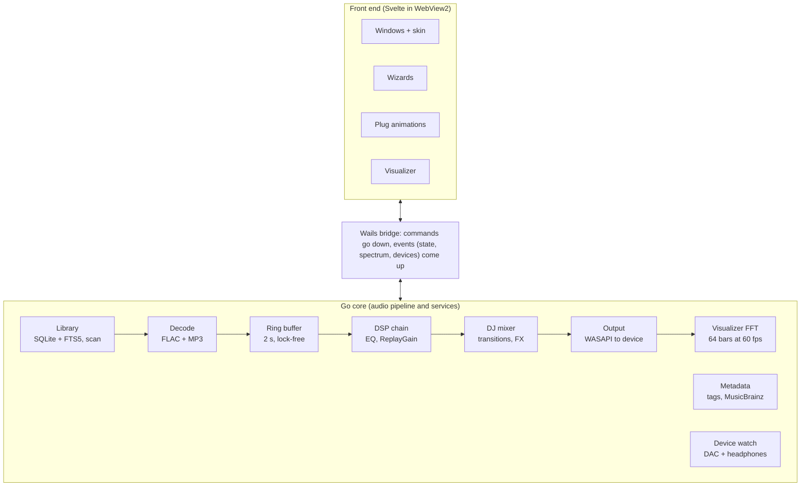
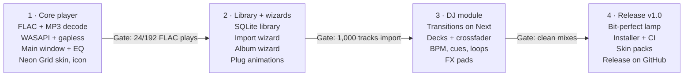

# Kororythm — Architecture Blueprint

_Nov 17, 2026 · living version: https://claude.ai/artifact/8G9purtHvHZQCbdq2Ng2Yf_

## Vision and scope

Kororythm is a Windows desktop player for FLAC and MP3 with a classic Winamp layout and a neon-grid look from 2000s sci-fi. It plays audio bit-perfect, manages a library through wizards, and adds DJ-style transitions and plug-in animations for DACs and headphones.

**MVP (first build):**

- Play FLAC (16/24-bit, up to 192 kHz) and MP3, gapless, with a playlist
- Classic main window, 10-band EQ, playlist editor and spectrum/oscilloscope visualizer
- Neon-grid skin and the parrot icon
- Import wizard (folders to library)
- DAC and headphone detection with their animations

**Later:** album-creation wizard, DJ decks and FX, tag editing, ReplayGain scanning, skin packs, mini mode, Android remote.

**Out of scope for v1:** streaming services, video, macOS/Linux builds.

The skin is an original design in the neon-grid style. It uses no film logos, names, fonts or characters, so the project stays safe to publish open source.

## Tech stack

Go for the engine plus a web front end in Wails, the same Go-first approach as Korokmote and TeleCyborg. The UI is a GPU-drawn web view (canvas/WebGL), which suits glow, grid and animation.

| Layer | Choice | Why |
| --- | --- | --- |
| App shell | Wails v2 (Go + WebView2) | One Windows .exe, native window and tray, Go to JS bindings |
| Audio output | malgo (miniaudio bindings) | WASAPI shared and exclusive modes, low latency, device events |
| FLAC decode | mewkiz/flac | Pure Go, 24-bit and high sample rates |
| MP3 decode | hajimehoshi/go-mp3 | Pure Go, stable |
| Resampling | Polyphase sinc resampler in Go (soxr through cgo as an option) | Only used when the device can't take the native rate |
| Tags read | dhowden/tag | ID3v1/v2, Vorbis comments, cover art |
| Tags write | bogem/id3v2, go-flac/flacvorbis | For the album wizard |
| Library DB | SQLite (modernc.org/sqlite, pure Go) with FTS5 | Fast search, no cgo |
| Device events | go-ole for IMMNotificationClient and IKsJackDescription | Plug and unplug detection, jack info |
| Metadata lookup | MusicBrainz API + Cover Art Archive (AcoustID optional) | Free, open data for the wizards |
| Front end | TypeScript + Svelte, Canvas2D/WebGL for the visualizer | Light, fast, easy to theme |
| Build/CI | GitHub Actions, windows-latest, `wails build` | Signed exe and installer (NSIS) |

## System architecture

Commands go down to the Go engine; state and sound data come back up.



Audio runs left to right through the Go pipeline. The library feeds file paths into Decode, the FFT taps the output for the visualizer, and device events go up to the UI to trigger the animations.

## Audio engine

The engine is a pull-based pipeline in Go. It decodes to 64-bit float, runs an optional DSP chain, and hands frames to WASAPI. In bit-perfect mode the DSP chain is skipped completely.

1. **Source:** `Decoder` interface (`Open`, `Read(frames)`, `Seek`, `Format`), with FLAC and MP3 implementations. A second decoder is pre-opened about 10 s before the track ends, for gapless play.
2. **Ring buffer:** about 2 s of lock-free buffer between the decode goroutine and the output callback, so the UI never causes dropouts.
3. **DSP chain** (each stage can be toggled):
   - ReplayGain (track or album) with a peak limiter
   - Preamp + 10-band graphic EQ (Winamp bands 60 Hz to 16 kHz), as biquad peaking filters
   - DJ mixer: crossfade and transition FX (see DJ module)
   - Optional "Boost" profile: loudness curve + soft clipper, with 3 dB headroom
   - Dither (TPDF) when going from float down to 16 or 24-bit
4. **Output:** malgo device. Shared mode by default; exclusive mode for DACs at the file's native rate and bit depth (no resampling, no Windows mixer).
5. **Taps:** a copy of the stream goes to an FFT (2048 points, Hann window). 64 spectrum bars + oscilloscope samples go to the UI at 60 fps.

**Player state machine:** Stopped → Loading → Playing ⇄ Paused → Stopped, plus Transitioning (when DJ FX runs between tracks). Every command (play, seek, next) is a message on one channel, so state changes stay ordered.

**Bit-perfect rule:** EQ, ReplayGain, Boost and DJ FX all off + exclusive mode + matching device format. The UI shows a "BIT-PERFECT" lamp only when all of these hold.

## Device detection and plug animations

A `devicewatch` service registers an `IMMNotificationClient` with Windows. It reacts to device added/removed, state changed and default device changed, then sorts each new endpoint into one of three kinds.

| Kind | How it's detected | Animation | Engine action |
| --- | --- | --- | --- |
| USB/external DAC | Endpoint enumerator is USB (or S/PDIF form factor) and the device lists formats above 48 kHz | **"Power Surge":** grid lines race in from the window edges, the panel shows the DAC name and its max format (e.g. 32-bit / 384 kHz), then a BOOST gauge sweeps to full | Offers to switch to exclusive bit-perfect mode and loads that DAC's saved EQ profile |
| Headphones | Form factor is Headphones or Headset, or the jack-detect state changes (IKsJackDescription) | **"Wings Up":** the parrot icon spreads its wings, its headphones glow, and a ring pulses out from the cups | Loads the headphone EQ profile and can lower volume about 6 dB to protect your ears |
| Speakers / other | Anything else | Short cyan scan line | Loads the default profile |

- **Unplug:** the reverse animation (lines retract, wings fold). Playback pauses if the active device is removed, as phones do.
- **Debounce:** events within 500 ms are merged, because Windows often fires several for one plug-in.
- **Profiles:** stored per device ID in SQLite (EQ, preamp, output mode, volume).
- **Honesty note:** "Boost" is a loudness and EQ profile plus headroom management. The real quality gain from a DAC comes from bit-perfect exclusive output, which is what the lamp shows.

## DJ module

Pressing Next (or a track ending) runs the chosen **transition**, so skipping a track sounds like a DJ mix instead of a hard cut. A DJ panel slides out of the main window to show the controls.

| Transition | What you hear | Default length |
| --- | --- | --- |
| Cut | Instant switch (classic Winamp) | 0 s |
| Crossfade | Equal-power fade between both tracks | 4 s |
| Scratch | Short vinyl-scratch sample, then the next track drops | 0.8 s |
| Rewind | Current track spins backward fast, then the next track drops | 1.2 s |
| Echo out | Delay tail on the outgoing track, next one fades in | 3 s |
| Filter sweep | Low-pass sweep closes the old track, high-pass opens the new one | 4 s |
| Vinyl brake | Pitch and speed fall to zero like a turntable stopping | 1 s |
| Beat-match (later) | Matches BPM and lines up beats before crossfading | 8 bars |

**DJ panel (phase 3):**

- Two decks (A/B) with a crossfader, waveform and BPM readout
- Pitch/tempo ±8% with key lock (time-stretch through a WSOLA/phase-vocoder stage)
- Hot cues (4 per track) and loops (1, 2, 4, 8 beats)
- FX pads: echo, flanger, filter, bitcrush, gate
- BPM and beat grid worked out at import time and stored in the library
- Button sounds: short UI clicks and "whoosh" sounds for skin buttons, which you can turn off. These go through a separate output so they're never recorded or mixed into the music.

All transition sounds are original or CC0 samples, kept in `assets/sfx/`.

## Library and wizards

The library is one SQLite file (`%APPDATA%\Kororythm\library.db`) with tables for tracks, albums, artists, playlists, device profiles and DJ data (BPM, cues). Files stay where they are; the database only indexes them.

**Import wizard ("Upload to the Grid"):**

1. Choose folders or drop files; you can also watch folders for new music
2. Scan: walk the folders in parallel, read tags and cover art, hash audio for duplicates
3. Review: tracks with missing tags are flagged, with one-click MusicBrainz suggestions
4. Analyze (in the background): duration, ReplayGain, BPM, waveform preview
5. Done: summary screen with counts, plus the "Upload complete" animation

**Album-creation wizard ("Compile Program"):**

1. Pick tracks from the library or a folder
2. Set album title, artist, year, genre and cover (file, drag-in, or Cover Art Archive search)
3. Order tracks by drag and drop, with auto-numbering and disc numbers
4. Choose to write tags into the files or keep the album as library-only
5. Optional: export as a folder copy with a clean naming scheme (`Artist/Year - Album/NN - Title.flac`)

**Other wizards:** first-run setup (pick output device, test tone, exclusive mode on or off), smart-playlist builder (rules like genre = X and BPM > 120), and a DAC setup wizard that runs on first plug-in.

Search uses FTS5 across title, artist, album and genre, and returns results as you type.

## UI, skin engine and icon

**Windows (Winamp layout):** main window (transport, seek bar, time display, kbps/kHz readout, mini visualizer), EQ window, playlist editor, library browser and DJ panel. They snap and dock to each other and can each be shown or hidden. There's also a mini mode (a thin bar) and a system-tray mode.

**Neon Grid skin (default):**

- Black background with a dark-blue perspective grid floor, cyan (#00E5FF) and orange (#FF6A00) light lines
- Thin rounded chrome with a soft outer glow; buttons light up on hover with a short scan line
- Readouts in a geometric display font (an open-licence font such as Orbitron, bundled)
- Visualizer modes: light-cycle bars, oscilloscope trail, and a tunnel grid that pulses on the beat
- Startup: the grid draws itself from a horizon line, then the windows fade in

**Skin engine:** a skin is a folder with `skin.json` (colours, fonts, layout positions), CSS variables and SVG sprites. Skins can be swapped live without restarting. Later, a classic .wsz importer can map old Winamp bitmaps onto the layout.

**Icon:** an original parrot with its wings spread, wearing over-ear headphones, drawn in neon line-art (cyan body, orange headphones). It's made as SVG, then exported to .ico at 16, 32, 48 and 256 px. A simplified version (head and headphones only) is used at 16 px so it stays readable. The same parrot is the mascot in the "Wings Up" headphone animation.

**Controls:** global hotkeys, media keys and Windows SMTC (media overlay and lock screen), plus drag and drop everywhere.

## Repo layout

```
kororythm/
  main.go                 # Wails entry point
  app.go                  # bindings exposed to the front end
  internal/
    engine/               # player state machine, ring buffer, gapless
    decode/               # flac.go, mp3.go, Decoder interface
    dsp/                  # eq, replaygain, boost, dither, resampler
    dj/                   # transitions, decks, fx, bpm
    output/               # malgo/WASAPI, exclusive mode
    devicewatch/          # IMMNotificationClient, jack detection
    library/              # sqlite schema, scanner, search
    meta/                 # tag read/write, MusicBrainz, cover art
    viz/                  # FFT, spectrum frames
  frontend/
    src/windows/          # main, eq, playlist, library, dj
    src/wizards/          # import, album, first-run, dac
    src/anim/             # power-surge, wings-up, boot-grid
    src/viz/              # canvas/WebGL visualizers
    skins/neon-grid/      # skin.json, sprites, fonts
  assets/icon/            # parrot.svg, .ico exports
  assets/sfx/             # transition and UI sounds (CC0/original)
  docs/ARCHITECTURE.md    # this blueprint
  .github/workflows/      # windows build + release
```

## Roadmap

Phase 1 starts today; each phase opens only when its gate passes.



Today's build target is phase 1: a Wails app that opens a FLAC file, plays it through WASAPI with a working seek bar and EQ, and wears the Neon Grid skin. Phase 2 starts once 24-bit/192 kHz FLAC plays with no dropouts.

## Risks and open decisions

- **Exclusive mode locks out other apps.** While it's on, Discord or a browser can't play sound through that DAC. Fix: make it a per-device toggle and release the device on pause.
- **Pure-Go FLAC speed** at 24/192 should be fine on modern CPUs, but needs a benchmark in phase 1. The fallback is libFLAC through cgo.
- **Event rate across the Wails bridge:** 60 fps spectrum frames are about 4 KB/s, which is fine. If it lags, switch to a local WebSocket carrying binary frames.
- **DAC detection is a heuristic.** Some DACs report as plain "Speakers". Fix: let the user tag a device as a DAC once, and remember it.
- **Time-stretch quality** for key lock is the hardest DSP piece, which is why it's deferred to phase 3.
- **Open decision:** Windows only, or plan for Linux/macOS from the start? (malgo and Wails both support them, but device detection is Windows-specific.)
